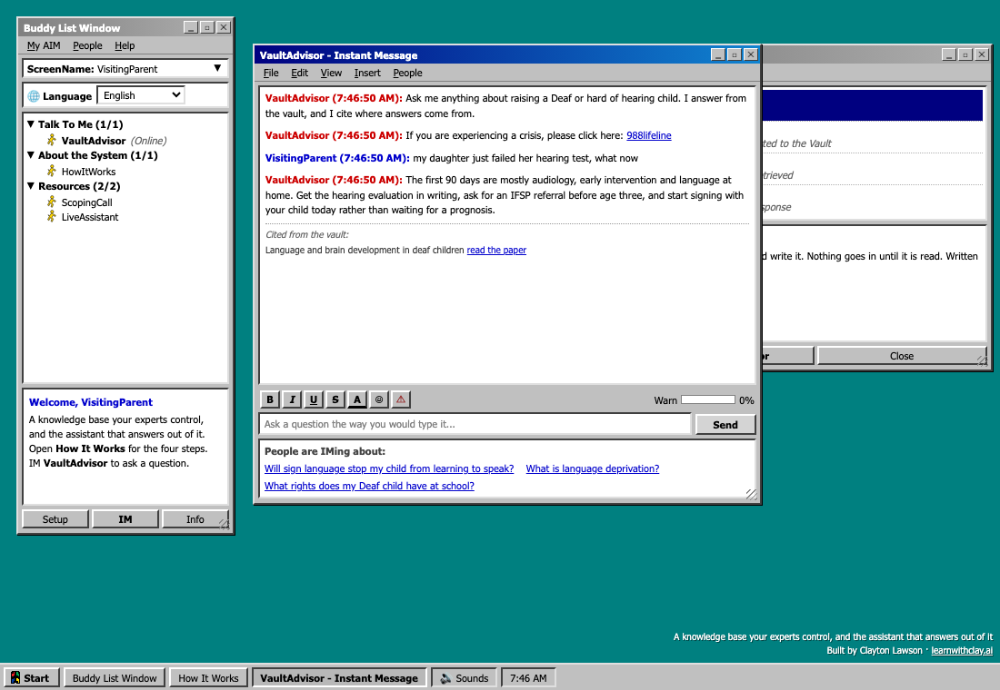

# Parent Advisor: Vault Preview

A working front end for the LearnWithClay Parent Advisor: a retrieval-augmented
advisor for hearing parents of Deaf and hard of hearing children. Answers are
grounded in a curated knowledge base and cite the notes they came from; a crisis
question gets resources first, before any research language.

It is deliberately period-correct: an AOL Instant Messenger / Windows 95 desktop,
because the parents this is built for remember that interface as the place where
they first talked to strangers about hard things.

- Live: https://learnwithclayparentadvisor.netlify.app
- Backend it calls: https://learnwithclay.ai/api/parent/chat
- No build step, no framework, no dependencies in the shipped page

## What it does

- **An IM window as the chat surface.** Buddy list, taskbar, windows you can drag
  and resize, sounds, a 1990s menubar. The chrome is the point: it lowers the
  stakes of asking a frightening question.
- **Answers arrive from a real RAG backend**, streamed into the transcript with a
  typewriter reveal, and the citation list links the notes behind the answer.
- **18 languages**, including right-to-left Arabic and Urdu. The picker
  retranslates the whole document in place: every translatable string is keyed by
  its English source text, so switching back to English is lossless.
- **A crisis path that cannot be lost in the ranking.** If the parent's own words
  match the safety patterns, the 988 line and the guardrails note lead the answer.
- **Keyboard and screen-reader behaviour**: the shell is made inert while a modal
  is open, Tab is trapped inside it, and every window is reachable from the
  taskbar.

## How the code is laid out

There is no build step: the browser loads four files in order.

| File | What lives there |
|---|---|
| `index.html` | markup only: the sign-on dialog, buddy list, IM window, taskbar, modal shell |
| `assets/styles.css` | the whole stylesheet, including the 18-language font stacks and RTL rules |
| `assets/app.js` | all behaviour: prefs, language wiring, windows, menus, composer, chat, citations, sanitizer |
| `i18n.js` | the translation runtime and the string table, keyed by English text |

`assets/app.js` opens with a structural map of its own regions, in order: config
and prefs, language, chrome, accessibility, menus, windows, sign-on, help,
composer, chat, transcript tools.

Screen to code:

| On screen | Markup | Behaviour |
|---|---|---|
| Sign-on dialog | `#signon` in `index.html` | `signOn`, `setScreenName`, `buildLangSelect` in `assets/app.js` |
| Buddy list | `#buddylist` | `openIM`, `refreshInert` |
| IM window and transcript | `#imwin`, `#chatTranscript` | `ask`, `reveal`, `typeOut`, `addMessage` |
| Citation list under an answer | inserted at runtime | `renderCitations`, `safeHref` |
| Composer and its toolbar | `#chatInput`, `#sendBtn` | `sendFromComposer`, `sanitizeRich`, `emotify` |
| Taskbar and windows | `#taskbar` | `setWin`, `focusWin`, `makeDraggable`, `makeResizable` |

## The API contract

One endpoint. The page posts a question and expects an answer plus citations.

    POST https://learnwithclay.ai/api/parent/chat
    Content-Type: application/json

    {"question": "...", "sessionId": "...", "language": "es"}

`question` is the plain text of the composer, truncated to 460 characters. When
the page is not in English, a short English tail is appended
(`(Answer in Spanish.)`) so retrieval keeps its English tokens while the model is
told which language to answer in. `sessionId` is a random id per browser session,
used by the backend for rate limiting rather than identity.

    200 OK
    {
      "answer": "The first 90 days are mostly audiology ...",
      "sources": ["Notes/First 90 Days After Diagnosis.md"],
      "citations": [
        {"title": "Language and brain development in deaf children",
         "url": "https://doi.org/10.1093/deafed/enz012",
         "citation": "Hall, M. (2019) ..."}
      ]
    }

- `answer` is required; without it the page shows its error line plus the
  routing hints for the question.
- `citations` is preferred; each entry needs `title` and either `url` or `doi`.
  Links are re-checked with `safeHref` before they reach the DOM, so a
  `javascript:` or `data:` URL from the API cannot become a live link.
- `sources` alone is enough: the page falls back to "answered from N vault notes".
- Any non-2xx, a network failure, or 25 seconds of silence falls back to a
  built-in preview answer, so the page never hangs on a dead backend.

The backend itself is a separate service; this repository only consumes it.

## Running it

Static, so anything that serves files works:

    python3 -m http.server 8080        # then open http://localhost:8080

Or run the Python host, which sends the same security headers as the deploy:

    python3 -m venv .venv && . .venv/bin/activate
    pip install -r requirements-dev.txt
    python3 app.py                     # http://127.0.0.1:8020, /healthz for liveness

## Tests

20 browser tests, no network and no live backend: the advisor endpoint is stubbed
with Playwright routing. They run under the deploy's Content-Security-Policy,
because a CSP violation is exactly the kind of breakage a headless run should
catch.

    pip install -r requirements-dev.txt
    python -m playwright install chromium
    python -m pytest

| File | What it pins down |
|---|---|
| `tests/test_shell.py` | the page loads with no console errors, assets are separate files (not re-inlined), the language picker is populated from `i18n.js`, sign-on opens the IM window, screen names are scrubbed |
| `tests/test_chat.py` | the question that goes on the wire (with `language` and `sessionId`), the answer and citations reaching the transcript, the fallback when the API fails, and that pasted or dropped HTML cannot inject markup |
| `tests/test_i18n.py` | switching language retranslates the document, the choice survives sign-on, switching back to English is lossless, Arabic sets `dir="rtl"` |

`tools/shots.py` regenerates the two screenshots above from the real page.
`tools/split_site.py` is the one-shot migration that moved the CSS and JS out of
`index.html`; it refuses to run on an already-split page.

## Status: what is not done

Working and in use: the chat surface, the 18-language picker, citations, the
crisis-first routing, keyboard and screen-reader behaviour, and the deploy.

Not done, in the order I would fix it:

1. **No streaming from the backend.** The answer arrives whole and the typewriter
   reveal is client-side theatre. Real token streaming needs an SSE endpoint and
   a different render path.
2. **`assets/app.js` is still one behaviour file** (about 1,900 lines) rather than
   the five-way split (state, i18n wiring, composer, sanitizer, render) the CSS
   and markup split implies. The browser tests exist now, which is what makes that
   next split safe; it is not done yet.
3. **Vocabulary is duplicated in three places**: the English strings in
   `assets/app.js`, the table in `i18n.js`, and the markup. A string added to one
   and not the others silently falls back to English.
4. **No visual regression baseline.** Layout assertions are structural, so a CSS
   change that breaks alignment but not the DOM would pass.
5. **The backend is not in this repo**, so the contract above is documented from
   the client side only.

## Contributing

Read the [Code of Conduct](CODE_OF_CONDUCT.md) before opening an issue or a pull
request. It is a Contributor Covenant 2.1 document with project-specific rules on
grounding answers in cited sources, Deaf-centered framing, keeping crisis handling
intact, and accessibility in how we work.

## Deploy

Netlify project `learnwithclayparentadvisor`. Publish directory is the repo root;
there is no build command. `netlify.toml` carries the security headers
(`script-src 'self'` now that the JavaScript is not inline) and an hour-long cache
for `i18n.js` and `assets/`. Any push to `main` deploys once the site is linked.

## License

The code is MIT. The knowledge base it answers from is not in this repository and
is not covered by that license.

## GitHub Pages demo

A read-only mirror of this page is published from `main` at

    https://claytonvlawson.github.io/learnwithclayparentadvisor/

GitHub Pages serves the repo root as-is (`.nojekyll` keeps every file, including
`assets/`), so the same `index.html` / `assets/app.js` / `i18n.js` that ship to
Netlify run there. The page calls the live advisor at
`https://learnwithclay.ai/api/parent/chat`; that endpoint allows the Pages origin
`https://claytonvlawson.github.io` in `api/parent/chat.js` of
`learnwithclay-site`. Without that entry the page still renders and answers with
the canned preview routing, but no live answers arrive.

Demo limits come from the API, not the page: 10 questions per IP per UTC day.
